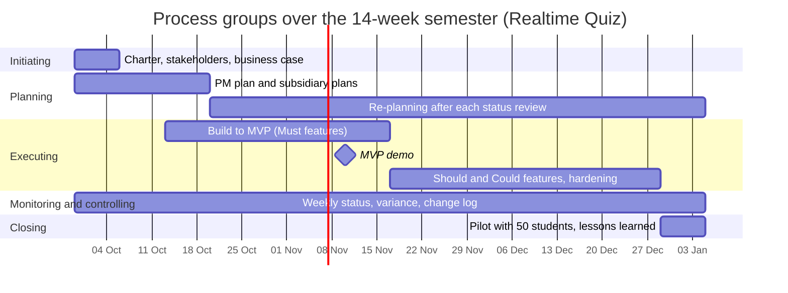

# Process groups mapping · Realtime Quiz

| Process group | Weeks active | Main activities | Outputs | Lab that produces them |
|---|---|---|---|---|
| Initiating | 1 | Defining project purpose, identifying initial stakeholders, business justification | Project charter, stakeholder list, business case | Lab 01 |
| Planning | 1-3, 4-14 | Establishing full project management plan, WBS, architecture design; continuous re-planning after sprint reviews | PM plan, subsidiary management plans, baseline updates | Labs 02, 03, 04 |
| Executing | 4-13 | Developing backend & frontend features, UI implementation, WebSocket integration, running load tests | Working software increments, MVP release, test reports | Labs 07, 08, 10, 12 |
| Monitoring and controlling | 1-14 | Weekly status meetings, tracking schedule/cost variance, managing risks and change requests | Status reports, change log, updated baselines | Labs 05, 06, 09 (tools), every lab (practice) |
| Closing | 14 | Conducting 50-student pilot session, handover to IT operations, documenting lessons learned | Completed pilot, operational runbook, final project report | Labs 13, 14 |

## Process groups over the semester

## Phase gates

1. **Week 1 — Charter approval (Initiating to Planning/Executing):**
   * *Decision:* Authorize the project to proceed and commit budget/resources.
   * *Evidence required:* Signed project charter, approved initial business case, and identified core stakeholder register.

2. **Week 7 — MVP demo review (Mid-execution checkpoint):**
   * *Decision:* Validate core product viability; decide whether to continue building the custom system or invoke the fallback plan (switch to buying a SaaS for next semester).
   * *Evidence required:* Live demonstration passing all "Must" features (quiz authoring, WebSocket live session, real-time leaderboard) with zero blocking defects.

3. **Week 13 — Pilot readiness review (Execution to Closing/Go-live):**
   * *Decision:* Authorize deployment to production for real student usage.
   * *Evidence required:* Load test report showing stability under 100 simulated concurrent students, Data Protection Officer (DPO) approval for student data storage, and operational runbook handed over to IT operations.